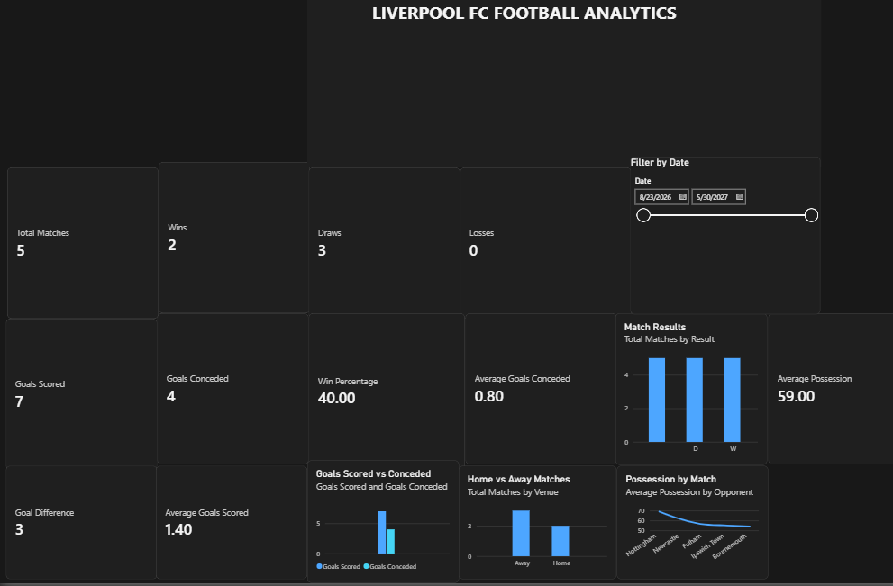

# Liverpool FC Football Analytics

## Project Overview

This project analyzes Liverpool FC match data using Python, SQL, and Power BI. The aim is to transform football match data into meaningful statistics, visualizations, and an interactive dashboard for understanding team performance.

## Objectives

- Collect Liverpool FC match data
- Clean and prepare the dataset
- Analyze match performance using Python and SQL
- Build an interactive Power BI dashboard
- Present key performance indicators and visualizations

## Tools and Technologies

- Python
- Pandas
- NumPy
- Matplotlib
- SQLite
- SQL
- Power BI
- DAX
- VS Code

## Data Source

Liverpool FC match data was obtained from FBref's Premier League match schedule and results data. The dataset contains match dates, opponents, venues, results, goals scored, goals conceded, possession, attendance, formations, and other match details.

1. Data Collection – Match data was collected from FBref.
2. Data Cleaning – Raw data was cleaned using Python and Pandas.
3. Data Analysis – Match results, goals, possession, and other KPIs were analyzed.
4. Database Creation – Cleaned data was stored in an SQLite database.
5. SQL Analysis – SQL queries were used to calculate performance metrics.
6. Dashboard Development – Power BI and DAX were used to create the interactive dashboard.

## Key Performance Indicators

- Total Matches: 5
- Wins: 2
- Draws: 3
- Losses: 0
- Goals Scored: 7
- Goals Conceded: 4
- Goal Difference: +3
- Win Percentage: 40%
- Average Goals Scored: 1.40
- Average Goals Conceded: 0.80
- Average Possession: 59%

## Dashboard Features

- KPI cards for overall team performance
- Match Results chart showing wins, draws, and losses
- Goals Scored vs Conceded comparison
- Home vs Away match analysis
- Possession by Match visualization
- Date slicer for interactive filtering
- Interactive Power BI dashboard for exploring match data

## Analysis Findings

- Liverpool completed 5 matches in the analyzed dataset.
- The team recorded 2 wins, 3 draws, and 0 losses.
- Liverpool scored 7 goals and conceded 4 goals.
- The overall goal difference was +3.
- Average possession was 59%.
- Liverpool recorded 2 wins and 1 draw in 3 away matches.
- The 2 home matches both ended in draws.
- Average goals scored per match was 1.40.
- Average goals conceded per match was 0.80.

## Limitations

- The dataset currently contains only 5 completed matches.
- Future fixtures are not included in completed-match performance calculations.
- The analysis is based on the available match-level data.
- Player-level statistics and advanced event data are not included in this version.

## Conclusion

This project demonstrates how football match data can be transformed into useful insights using Python, SQL, and Power BI. The analysis provides a clear view of Liverpool FC's results, goals, possession, and home-away performance through an interactive dashboard. The project can be further expanded with player statistics, advanced performance metrics, and updated match data.

## Future Enhancements

- Add player-level performance statistics
- Include shots, assists, passes, and defensive metrics
- Add more advanced football analytics
- Update the dataset automatically after new matches
- Add predictive analysis using machine learning
- Improve the Power BI dashboard with additional interactive filters

## Project Structure

Liverpool_Football_Analytics/
├── data/
├── Power BI/
├── python/
├── report/
└── SQL/

## Database

The cleaned Liverpool match dataset was stored in an SQLite database named `liverpool_analytics.db`. The main table used for analysis is `liverpool_matches`, which contains the cleaned match records and related performance information.

## Python Analysis

Python was used for data loading, cleaning, analysis, and visualization. Pandas was used to process the match dataset, while Matplotlib was used to create charts for Liverpool's match results and goals. The analysis focused on completed matches only.

## Power BI Dashboard

Power BI was used to create an interactive football analytics dashboard. DAX measures were created to calculate total matches, wins, draws, losses, goals scored, goals conceded, goal difference, win percentage, average goals, and average possession. Interactive charts and a date slicer were added to support visual analysis.

## SQL Analysis

SQL queries were used with SQLite to retrieve completed matches and calculate key performance indicators such as wins, draws, losses, goals scored, goals conceded, goal difference, and average possession.

## Dashboard Screenshot

## References

1. FBref – Liverpool FC Premier League match data
2. Microsoft Power BI documentation
3. Python Pandas documentation
4. SQLite documentation
